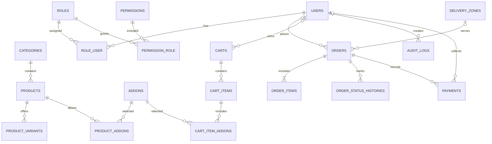

# Savoury Spot — Database ERD (Phase 2)

Money columns use **PKR minor units** (`*_minor`, paisa). Public/view models expose `*_pkr`.  
Timestamps: **UTC** storage, **Asia/Karachi** display (`config/savoury.php`).

## Entity relationship diagram

## Table inventory

| Table | Notes |
|---|---|
| `users` | Staff/admin; `is_active` |
| `roles`, `permissions`, pivots | RBAC |
| `categories` | Soft deletes |
| `products` | `price_minor`, `is_available`, `is_active`, `is_featured`, soft deletes |
| `product_variants` | Absolute `price_minor` |
| `addons`, `product_addons` | Optional add-ons |
| `delivery_zones` | `delivery_fee_minor`, `min_order_minor`, `coverage_notes` (unseeded) |
| `carts`, `cart_items`, `cart_item_addons` | Optional persisted carts |
| `orders` | `public_reference`, `tracking_token_hash`, `payment_method`, money snapshots, statuses |
| `order_items` | Name/price snapshots + addons JSON |
| `order_status_histories` | Transition audit |
| `payments` | Cash collection separate from order status |
| `business_hours` | Unique `day_of_week`; unseeded |
| `restaurant_settings` | Key/value config; unseeded |
| `audit_logs` | Morph audit trail |

## Status values

Stored: `pending`, `accepted`, `preparing`, `ready`, `out_for_delivery`, `delivered`, `collected`, `cancelled`, `rejected`.

Display note: `ready` maps to **Ready for Pickup** for pickup orders.

## Intentionally empty until owner input

Delivery zones, fees, min orders, hours, address/settings, featured flags.
